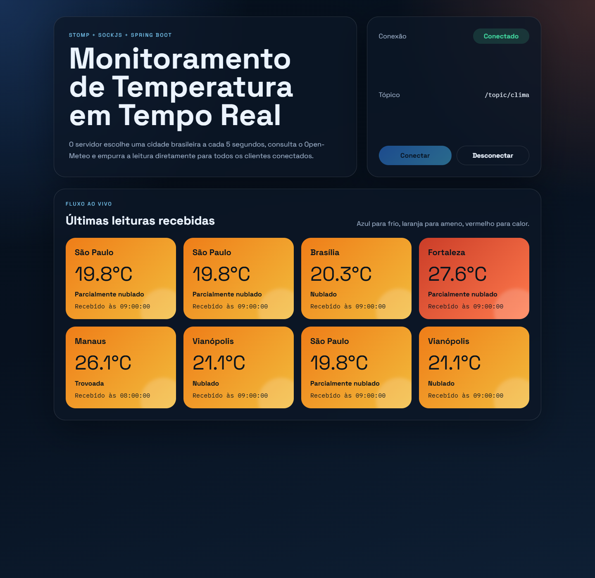

# Monitoramento de Temperatura em Tempo Real com WebSockets

Sistema distribuído de monitoramento climático usando Spring Boot, STOMP sobre WebSockets e SockJS. O servidor escolhe uma cidade brasileira aleatória a cada 5 segundos, consulta a temperatura atual no Open-Meteo e faz broadcast da leitura para todos os clientes conectados, sem polling.



## Tecnologias

- Java 21
- Spring Boot 4
- Spring WebSocket com STOMP
- SockJS
- Open-Meteo API
- HTML, CSS e JavaScript vanilla

## Funcionalidades

- Endpoint WebSocket com SockJS em `/ws-clima`
- Broker STOMP publicando mensagens em `/topic/clima`
- Envio automático de novas leituras a cada 5 segundos com `@Scheduled`
- Seleção aleatória entre 10 cidades brasileiras pré-definidas
- Dashboard em tempo real com status de conexão
- Cards com cor dinâmica por faixa de temperatura

## Cidades monitoradas

- São Paulo
- Rio de Janeiro
- Brasília
- Salvador
- Recife
- Fortaleza
- Curitiba
- Porto Alegre
- Manaus
- Vianópolis

## Estrutura da mensagem

O servidor publica mensagens JSON no tópico `/topic/clima` com o formato abaixo:

```json
{
  "cidade": "Vianópolis",
  "temperatura": 28.5,
  "descricao": "Céu limpo",
  "horario": "18:25:00"
}
```

## Fluxo de mensagens

1. O `ClimateScheduler` dispara `publishRandomClimateUpdate()` a cada 5 segundos.
2. O `CityCatalog` escolhe uma cidade aleatória e o `OpenMeteoWeatherClient` consulta o Open-Meteo com latitude, longitude e `current=temperature_2m,weather_code`.
3. O `ClimateBroadcastService` converte a resposta da API para `ClimateUpdate` e publica no broker STOMP em `/topic/clima`.
4. Os clientes web inscritos no tópico recebem a mensagem imediatamente e atualizam o dashboard sem recarregar a página.

## Como rodar o projeto

### Pré-requisitos

- Java 21 instalado
- Conexão com a internet para consultar a API do Open-Meteo

### Executando no Windows

```powershell
./mvnw.cmd spring-boot:run
```

### Executando no Linux ou macOS

```bash
./mvnw spring-boot:run
```

Depois disso, abra:

```text
http://localhost:8080
```

## Rodando os testes

### Windows

```powershell
./mvnw.cmd test
```

### Linux ou macOS

```bash
./mvnw test
```

## Estrutura do projeto

```text
src/main/java/com/dlr1337/websocket
├── config
├── model
└── service

src/main/resources
├── application.properties
└── static
    ├── app.js
    ├── index.html
    └── styles.css
```

## Interface web

- Status da conexão: `Conectado` ou `Desconectado`
- Lista de medições recebidas em tempo real
- Cores dos cards:
  - Azul: até 18°C
  - Laranja: entre 18.1°C e 27°C
  - Vermelho: acima de 27°C

## Observações

- O frontend é servido pelo próprio Spring Boot, então não há necessidade de um servidor separado.
- O Open-Meteo é utilizado sem chave de API.
- O dashboard mantém as 20 leituras mais recentes para evitar crescimento infinito da tela.
