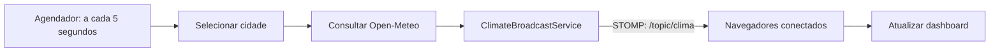

# Clima em tempo real

**Um dashboard que recebe atualizações de temperatura por WebSocket, sem precisar recarregar a página.**

Projeto de sistemas distribuídos em Java e Spring Boot. O servidor consulta dados meteorológicos de cidades brasileiras e distribui cada leitura aos navegadores inscritos em um tópico STOMP. A interface é servida pela própria aplicação, sem um frontend separado para instalar.

[Interface](#interface) · [Como funciona](#como-funciona) · [Executar](#como-executar) · [Contrato das mensagens](#contrato-das-mensagens) · [Código](#organização-do-código)

## Interface


*Captura da aplicação já versionada no repositório. Os valores exibidos são os da captura, não uma previsão atual.*

## O que o projeto demonstra

| Recurso | Implementação |
| --- | --- |
| Atualizações no navegador | STOMP sobre WebSocket, com suporte a SockJS. |
| Coleta periódica | Seleção de uma cidade a cada 5 segundos e consulta ao Open-Meteo. |
| Distribuição | Broadcast no tópico `/topic/clima` para os clientes inscritos. |
| Interface | Estado da conexão, cards de temperatura e lista das 20 leituras mais recentes. |
| Tratamento de falhas | Falhas de consulta são registradas no servidor, sem fabricar uma leitura. |
| Empacotamento | Backend e arquivos estáticos na mesma aplicação Spring Boot. |

> É uma demonstração de comunicação em tempo real. A coleta não acompanha todas as cidades simultaneamente: uma cidade do catálogo é sorteada em cada ciclo. A chegada de uma leitura depende da disponibilidade da API externa.

## Como funciona



1. `ClimateScheduler` aciona a publicação periódica.
2. `CityCatalog` seleciona uma cidade; `OpenMeteoWeatherClient` consulta latitude, longitude, temperatura e código do tempo.
3. `ClimateBroadcastService` monta um `ClimateUpdate` e o envia com `SimpMessagingTemplate`.
4. O navegador recebe a mensagem e atualiza a interface sem solicitar repetidamente os mesmos dados ao backend.

**Distinção importante:** o navegador recebe eventos; o servidor ainda faz consultas periódicas ao provedor meteorológico.

O catálogo contém São Paulo, Rio de Janeiro, Brasília, Salvador, Recife, Fortaleza, Curitiba, Porto Alegre, Manaus e Vianópolis.

## Tecnologias

| Área | Stack do repositório |
| --- | --- |
| Linguagem | Java 21. |
| Aplicação | Spring Boot 4.0.5 e Spring Web MVC. |
| Mensageria web | Spring WebSocket, STOMP e SockJS. |
| Interface | HTML, CSS e JavaScript sem framework. |
| Fonte de dados | Open-Meteo. |
| Build e testes | Maven Wrapper e Spring Boot Starter Test. |

As versões de build estão em [pom.xml](pom.xml).

## Como executar

### Requisitos

Java 21, Git e acesso à internet para baixar dependências e consultar o serviço meteorológico. O Maven Wrapper acompanha o projeto; não é necessário instalar Maven separadamente.

```bash
git clone https://github.com/dlr-1337/monitoramento-temperatura-websocket.git
cd monitoramento-temperatura-websocket
```

**Linux ou macOS:**

```bash
./mvnw spring-boot:run
```

Se o wrapper não tiver permissão de execução, use `chmod +x mvnw` antes do comando.

**Windows / PowerShell:**

```powershell
.\mvnw.cmd spring-boot:run
```

Abra **http://localhost:8080**. Aguarde a conexão e a primeira leitura. Abra uma segunda aba para observar a distribuição da mesma atualização a mais de um cliente.

## Contrato das mensagens

| Elemento | Valor |
| --- | --- |
| Endpoint de conexão | `/ws-clima` |
| Tópico de assinatura | `/topic/clima` |
| Payload | JSON com cidade, temperatura, descrição e horário. |

Exemplo ilustrativo do formato:

```json
{
  "cidade": "Vianópolis",
  "temperatura": 28.5,
  "descricao": "Céu limpo",
  "horario": "18:25:00"
}
```

Na interface, os cards mudam de cor conforme a faixa de temperatura: azul até 18 °C, laranja acima de 18 °C e até 27 °C, e vermelho acima de 27 °C.

## Organização do código

```text
src/main/java/com/dlr1337/websocket/
├── config/       # Configuração de comunicação
├── model/        # Cidade, leitura e mensagem distribuída
└── service/      # Catálogo, consulta, agendamento e broadcast
src/main/resources/
├── application.properties
└── static/       # index.html, app.js e styles.css
docs/img/         # Captura do dashboard
```

- [Serviços e integração meteorológica](src/main/java/com/dlr1337/websocket/service/)
- [Modelos de mensagem](src/main/java/com/dlr1337/websocket/model/)
- [Interface web](src/main/resources/static/)

## Testes

```bash
# Linux / macOS
./mvnw test
```

```powershell
# Windows
.\mvnw.cmd test
```

Os comandos executam a suíte presente no repositório; não representam uma certificação de disponibilidade do Open-Meteo.

## Limitações e diagnóstico

O dashboard mantém somente as 20 leituras mais recentes na tela. Não deve ser interpretado como histórico meteorológico persistente, sistema de alerta operacional ou fonte para decisões críticas.

Se a página abrir sem leituras, confira o estado da conexão, o console do navegador e os logs do servidor. Falhas de consulta ao Open-Meteo são registradas com a cidade e o erro correspondente.
